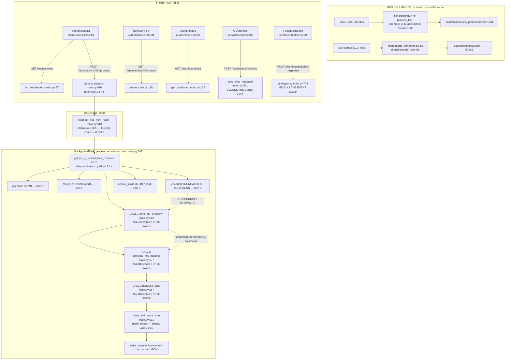

# SwissHacks2025 — Full Codebase Audit

> ## ⚠️ Status: this document describes the code as it was on 2026-07-25
>
> The roadmap in §9 has since been implemented on branch
> `feat/roadmap-implementation` (commits `3c8f0a8`, `d2a5d5a`). **Sections 3–7
> below describe the *old* code and are kept as the historical record — do not
> read them as a description of the current system.** See
> [Implementation status](#implementation-status) for what changed, and the
> [README](../README.md) for how the code works now.

## Implementation status

Verified on 2026-07-26 against a clean start of both services.

| Roadmap phase | State | Evidence |
|---|---|---|
| Phase 1 — quick wins | **Done** (10/10) | commit `3c8f0a8` |
| Phase 2 — structural fixes | **Done** (10/10) | commit `d2a5d5a` |
| Phase 3 — longer-term | **Done, with one item deliberately scoped down** | commit `d2a5d5a` |

**Measured after the changes:**

| Metric | Before | After |
|---|---|---|
| Retrieval per call | 3.5 s (0.577 s JSON load + 2.613 s model construction) | **0.017–0.068 s** |
| Poll latency during a chat call | 7.645 s | **1.2–5.5 ms** |
| Aggregate prompt size | ~97,800 tokens × 3 | summaries + context, a few thousand tokens × 3 |
| Model calls per run | 3 sequential | N document summaries (concurrent, cached) + 3 concurrent aggregates |
| `?filename=../../../../../../../etc/passwd` | returned `/etc/passwd` | **404** |
| Arbitrary `Origin` with credentials | reflected | **not reflected** |
| Second `POST /process` while running | silently raced the first | **409** |
| npm vulnerabilities | 13 (2 critical, 8 high) | **3 (0 critical, 3 high, all transitive via `next`)** |
| Backend tests | 0 | **96, passing** |
| Frontend type errors in build | suppressed by config | **0, and checking is enforced again** |
| Retrieval quality | all 3 submissions returned the same Florida hurricane files | three distinct, plausible result sets |

**Not done, and why:**

- **SEC-002 per-user data scoping.** Implemented as a single shared bearer token
  (`API_TOKEN`) rather than user accounts, per an explicit decision — the app has
  no user model and inventing one was out of scope. This closes "anyone who can
  reach the port owns the API" but *not* "user A can read user B's submissions".
  Tracked in [`data-handling.md`](data-handling.md).
- **IMP-005 model benchmark.** The knobs (`timeout`, `max_completion_tokens`,
  `reasoning_effort`, `OPENAI_MODEL`) are implemented and the default is
  unchanged at `o3-mini` so quality does not shift silently. The benchmark
  *itself* could not be run — no API key was available — so it ships as
  `backend/scripts/benchmark_models.py` for you to run.
- **Real end-to-end LLM verification.** Everything on the model path is covered
  by tests with the model stubbed. **No production OpenAI call has been made
  against this code.** Run one analysis with a real key before trusting it.
- **Git history rewrite.** The 50 MB `embeddings.json` is removed from the
  working tree and superseded by a gitignored build artifact, but it remains in
  history (`size-pack: 46.21 MiB`). Rewriting shared history is your call.

---

## Status ledger

**Every finding in §5–§7, with its current state.** Check here before starting
work on anything below — most of it is already done.

Legend: ✅ fixed and verified · 🟡 partly done, remainder noted · ⭕ open

### Bugs

| ID | Status | Where / note |
|---|---|---|
| BUG-001 | ✅ | `2223cc4` — `tempfile` removed from `requirements.txt` |
| BUG-002 | ✅ | `3c8f0a8` — date-fns 3, react-day-picker 9, vaul 1; plain `npm install` works |
| BUG-003 | ✅ | `d2a5d5a` — `clean_and_parse_json` deleted; `schemas.py` + `llm.structured` |
| BUG-004 | ✅ | `d2a5d5a` — `chunking.py`, `retrieval.py`, `scripts/build_index.py` |
| BUG-005 | ✅ | `3c8f0a8` — sync handlers; polls 7.645 s → 1.2–5.5 ms |
| BUG-006 | ✅ | `3c8f0a8` — mock fallbacks removed from `ai.service.ts` |
| BUG-007 | ✅ | `3c8f0a8`, `d2a5d5a` — real status + error surfaced |
| BUG-008 | ✅ | `3c8f0a8` — polling resumes after reload |
| BUG-009 | ✅ | `d2a5d5a` — `jobs.claim()`; second start returns 409 |
| BUG-010 | ✅ | `d2a5d5a` — `recover_all_processing()` at boot + 120 s call timeout |
| BUG-011 | ✅ | `3c8f0a8` — `COLORS` hoisted to module scope |
| BUG-012 | ✅ | `3c8f0a8` — empty chart data renders an empty state |
| BUG-013 | ✅ | `d2a5d5a` — generator replaced by `scripts/build_index.py` |
| BUG-014 | ✅ | `d2a5d5a` — POSIX keys via `as_posix()` |
| BUG-015 | ✅ | `3c8f0a8` — per-request `mkdtemp()` |
| BUG-016 | ✅ | `3c8f0a8` — `/generate-pdf` is a sync handler |
| BUG-017 | ✅ | `3c8f0a8` — `AIQueryError` instead of `HTTPException` in a background task |
| BUG-018 | ✅ | `d2a5d5a` — one `contentId` per selection |
| BUG-019 | ✅ | `3c8f0a8` — persisted to `data/feedback/*.jsonl` |
| BUG-020 | ✅ | `d2a5d5a` — `params` awaited |
| BUG-021 | 🟡 | `d2a5d5a` — TypeScript re-enabled, 0 errors, build passes. **ESLint is still `ignoreDuringBuilds`** because the project has no ESLint config; adding one is open. |
| BUG-022 | ✅ | `d2a5d5a` — `export-pdf` honours `API_URL` |
| BUG-023 | ✅ | `3c8f0a8` — duplicate dependency keys removed |
| BUG-024 | ✅ | `3c8f0a8` — only `package-lock.json` kept |
| BUG-025 | ✅ | `3c8f0a8` — timezone-aware timestamps |
| BUG-026 | ✅ | `d2a5d5a` — dead parameter gone with `cached_ai_query` |
| BUG-027 | 🟡 | `d2a5d5a` — cache split into `data/llm_cache/` vs `data/ai_cached/`. **No TTL or size cap yet**; both still grow without bound. |

### Improvements

| ID | Status | Where / note |
|---|---|---|
| IMP-001 | ✅ | `3c8f0a8`, rebuilt in `d2a5d5a` — aggregates run concurrently |
| IMP-002 | ✅ | `3c8f0a8` — singletons; retrieval 3.5 s → 0.017–0.068 s |
| IMP-003 | ✅ | `d2a5d5a` — SSE end to end, including through the Next proxy |
| IMP-004 | ✅ | `d2a5d5a` — map-reduce over cached per-document summaries |
| IMP-005 | 🟡 | `d2a5d5a` + the §4.3b follow-up — timeout 120 s, `max_completion_tokens`, `reasoning_effort=low`, default model switched to a non-reasoning one. **The benchmark itself has never been run** — no API key. Run `scripts/benchmark_models.py`. |
| IMP-006 | ✅ | `d2a5d5a` — structured outputs + Pydantic validation |
| IMP-007 | ✅ | `d2a5d5a` — chunk-level retrieval both sides |
| IMP-008 | ✅ | `d2a5d5a` + the §4.3b follow-up — content-hash cache for summaries and responses |
| IMP-009 | ✅ | `d2a5d5a` — per-step progress, not 0/33/66/100 |
| IMP-010 | ✅ | `d2a5d5a` — `POST /submissions/{id}/cancel` + UI button |
| IMP-011 | ✅ | `3c8f0a8` — structured logging, no payloads |
| IMP-012 | 🟡 | `d2a5d5a` — index is a gitignored `.npz` artifact. **The 50 MB blob is still in git history**; rewriting it is your call. |
| IMP-013 | ✅ | `d2a5d5a` + the §4.3b follow-up — 100 backend tests |
| IMP-014 | ✅ | `3c8f0a8`, `d2a5d5a` — README rewritten |
| IMP-015 | ✅ | `d2a5d5a` — `POST /submissions` accepts uploads |
| IMP-016 | ✅ | `d2a5d5a` — `config.py`, paths from `__file__`, env-overridable |
| IMP-017 | ✅ | `d2a5d5a` — dead constants removed |

### Security

| ID | Status | Where / note |
|---|---|---|
| SEC-001 | ✅ | `3c8f0a8`, `d2a5d5a` — containment check; traversal returns 404 (verified) |
| SEC-002 | 🟡 | `d2a5d5a` — bearer token on every route, injected server-side. **No per-user scoping** — one shared token, everyone sees every submission. Deliberate: there is no user model. |
| SEC-003 | ✅ | `3c8f0a8` — origin allowlist (verified not reflected) |
| SEC-004 | ✅ | `d2a5d5a` — untrusted content fenced and labelled as data |
| SEC-005 | ✅ | `d2a5d5a` — DOMPurify in `components/safe-html.tsx` |
| SEC-006 | ✅ | `3c8f0a8` — payloads never logged |
| SEC-007 | ✅ | `d2a5d5a` — `/results` mount is opt-in; cache dirs separated |
| SEC-008 | 🟡 | `d2a5d5a` — documented in [`data-handling.md`](data-handling.md). **The policy decisions in that file have no owner yet.** |
| SEC-009 | 🟡 | `d2a5d5a` — 13 → 3 vulnerabilities, 0 critical. The remaining 3 are transitive (`postcss`, `sharp`) and need a `next` major bump. |
| SEC-010 | ✅ | `d2a5d5a` — confirmed clean; `.env.example` added |
| **SEC-011** | ⭕ | **NEW — found after the audit. Not yet fixed.** See below. |

### Cost

| ID | Status | Where / note |
|---|---|---|
| COST-001 | ✅ | Map-reduce removes the 3× duplication |
| COST-002 | ✅ | Last 10 turns only, plus a cached summaries block |
| COST-003 | ✅ | Feedback revises one section, not the whole dashboard |
| COST-004 | ✅ | Retrieval fixed, so context tokens are no longer wasted |
| COST-005 | 🟡 | Prompts now lead with a static prefix (`SYSTEM_RULES`), which is cache-friendly. **Never measured** — no API key. |
| COST-006 | ✅ | Model and index are process-wide singletons |

### SEC-011 — API token committed into the git remote URL

| | |
|---|---|
| **Severity** | **Critical** |
| **Status** | ⭕ **Open — needs you, I cannot rotate a credential** |
| **Evidence** | `git remote -v` → `https://ghp_***@github.com/olivierluethy/SwissHacks2025.git`, stored in plaintext in `.git/config` |
| **Impact** | Anyone with read access to that machine, a backup, or a copy of the repo directory has push access to the GitHub account. |
| **Fix** | Rotate the token at <https://github.com/settings/tokens>, then `git remote set-url origin https://github.com/olivierluethy/SwissHacks2025.git` and use a credential helper or SSH. |
| **Also** | GitHub reports 74 Dependabot alerts on the default branch (2 critical, 33 high) — a superset of the npm findings in SEC-009, including Python dependencies. |

---

**Audit date:** 2026-07-25
**Repo state:** branch `main`, commit `f54dae6` ("Delete unused files"), working tree clean at start
**Scope:** analysis only. No features were built, nothing was refactored. The only code changes are the two minimal fixes needed to start the app (see §11).
**Environment used for measurements:** Linux 6.8.0-100-generic, Python 3.12.3, Node v24.18.0, npm 11.16.0, no GPU available to PyTorch (CUDA init failed → CPU inference).

**Evidence convention:** every claim below is backed by a `file:line` reference, a command output, or a timing measured on this machine. Anything I could not verify is explicitly tagged **`UNVERIFIED — hypothesis`**.

**One important limitation, stated up front:** no `OPENAI_API_KEY` was available in this environment, so I could **not** measure the latency of a real OpenAI call. I worked around this by measuring *everything else* precisely (the entire local pipeline is **4.27 s**) and by counting the exact prompt tokens that get sent (**~97,800 tokens × 3 sequential calls**). The conclusion about the bottleneck follows by arithmetic from those two measurements, not by guesswork — but the per-call latency figures themselves are estimates and are labelled as such.

---

## 1. Executive summary

1. **Your description of the app is roughly half right.** It does summarise/structure data with OpenAI, produce an aggregated dashboard, and let you chat about it. But it does **not** extract data at runtime: there is no upload endpoint, no scraping, no API ingest. The extraction code (`backend/data/file_parser.py`) is a standalone offline script that is **never imported by the running server** (`backend/main.py` has no reference to it). The app only reads Markdown that is already on disk in `backend/data/submissions_processed/`.
2. **The slowness is not extraction. It is three sequential, un-streamed, un-chunked calls to a reasoning model, each carrying the entire submission corpus.** Measured: the complete local pipeline (file reads, embedding, retrieval, JSON parsing, all disk writes) takes **4.27 s** end-to-end (`backend/main.py:547`). Measured: each of the three prompts is **451,464 / 451,800 / 452,880 characters ≈ 97,800 tokens**. They run one after another at `main.py:569`, `main.py:577`, `main.py:587`. Everything above ~4 s of wall clock is OpenAI.
3. **The RAG retrieval is broken and silently returns the wrong documents for every submission.** `all-MiniLM-L6-v2` has `max_seq_length = 256`, but `data_endpoints.py:105` embeds the whole concatenated submission — measured at **104,832 tokens** for `netherlands`. Only the first 256 word-pieces are ever seen. Result, measured: the Netherlands and Turkey submissions both retrieve **Florida hurricane claims files** as their "context". You are paying ~7,000 tokens per call to feed the model irrelevant data.
4. **Any long AI operation freezes the entire API.** `send_chat_message` (`main.py:311`) and `get_ai_response_to_feedback` (`main.py:746`) are `async def` but call blocking code directly. Measured: a baseline `GET /submissions` takes **0.9 ms**; the same request issued during a chat call took **7.645 s** — it was queued behind the blocking work. With a real API key that block lasts for the entire model call, so the status-polling the UI depends on stops responding.
5. **Unauthenticated arbitrary file read.** `GET /get-file-contents?filename=../../../../../../../etc/passwd` returned `/etc/passwd`; `?filename=../../main.py` returned the backend source. `backend/data/data_endpoints.py:74` joins user input straight onto a base path. There is no authentication anywhere in the app.
6. **The JSON "repair" function destroys valid model output.** `clean_and_parse_json` (`main.py:531`) throws on the valid JSON `{"markdown": "Loss ratio, combined: 92%"}` — its regex rewrites text *inside* string values. It also cannot handle prose preamble or truncated output. When it throws, `main.py:594` marks the run `failed`.
7. **A failed run is invisible in the UI and looks like "never started".** `GET /submissions` collapses every non-`completed` state to `"pending"` (`main.py:114`), and the frontend maps unknown states to `pending_analysis` (`submission-list.tsx:64`). Measured: after a run failed, the list endpoint returned `{"id":"netherlands","status":"pending"}`. The user sees an "Analyze" button again and re-runs — which is very likely a large part of "it takes extremely long".
8. **When the backend errors, the frontend silently shows fabricated demo data as if it were the analysis.** `ai.service.ts:272` returns `mockDashboardData` (a fitness-tracker table) on any dashboard fetch failure; `:170` and `:293` do the same for submissions and chat. For an underwriting tool this is a trust-critical defect.
9. **Cost is dominated by pure duplication.** The same ~90k-token corpus is transmitted three times per run and again on every chat message and every thumbs-up click. Estimated ≈ **$0.38 per analysis run**, of which ≈ $0.21 is re-sending identical bytes.
10. **Structurally**, this is a hackathon prototype with prototype seams: no queue, no database, no vector store, JSON files as the datastore, a 50 MB `embeddings.json` re-parsed from disk and a SentenceTransformer re-instantiated **on every single call** (measured 0.58 s + 2.6 s each time), a 48 MB blob committed twice into git history, `next.config.mjs` disabling both TypeScript and ESLint checks, and 13 npm vulnerabilities (2 critical).

---

## 2. How to run it

Verified working on this machine. **Note:** on this machine port **8000 was already occupied** by an unrelated process (`ss -ltnp` shows a listener on `0.0.0.0:8000` that accepts connections and never responds; uvicorn failed with `[Errno 98] error while attempting to bind on address ('0.0.0.0', 8000): address already in use`). I therefore ran the backend on **8010**. If port 8000 is free on your machine, use the plain commands and skip the `API_URL` override.

### Required environment variables

| Variable | Where | Required? | Notes |
|---|---|---|---|
| `OPENAI_API_KEY` | backend shell env | **Yes — the server will not even start without it** | Read at `backend/main.py:27` at *import* time. You must set this yourself; I did not and will not generate a value. Get it from <https://platform.openai.com/api-keys>. |
| `API_URL` | frontend shell env | Only if the backend is not on `http://localhost:8000` | Used by the proxy route, `frontend/app/api/proxy/[...path]/route.ts:21`. |
| `NEXT_PUBLIC_API_MODE` | frontend | No | `"mock"` switches the whole app to fake data (`ai.service.ts:4`). Leave unset. |

### Backend

```bash
cd /home/neuadmin/Documents/SwissHacks2025/backend
python3 -m venv .venv
.venv/bin/pip install -r requirements.txt      # ~5.6 GB installed, ~9 min on this machine
export OPENAI_API_KEY=<your key here>          # do NOT commit this
.venv/bin/python main.py                       # binds 0.0.0.0:8000 (hardcoded, main.py:965)
```

If port 8000 is taken, run instead (this is what I used):

```bash
.venv/bin/python -m uvicorn main:app --host 0.0.0.0 --port 8010
```

You **must** run from inside `backend/` — `data/embeddings.json` (`data_endpoints.py:19`) and `./fonts/DejaVuSerif.ttf` (`main.py:891`) are CWD-relative paths.

### Frontend

```bash
cd /home/neuadmin/Documents/SwissHacks2025/frontend
npm install --legacy-peer-deps    # plain `npm i` FAILS, see BUG-002
npm run dev
```

If the backend is not on port 8000:

```bash
API_URL=http://localhost:8010 npm run dev
```

### URLs (verified with real requests)

| What | URL | Verification |
|---|---|---|
| **Frontend** | **<http://localhost:3000>** | `GET / → 200` in 1.12 s; page contains "AI-Powered Reinsurance Analytics" |
| Frontend dashboard route | <http://localhost:3000/dashboard/netherlands_dashboard> | `GET → 200` in 4.17 s |
| **Backend / API** | **<http://localhost:8000>** (I used **<http://localhost:8010>**) | `GET /submissions → 200` in 4.6 ms, body `[{"id":"netherlands"},{"id":"turkey"},{"id":"florida"}]` |
| **API docs (Swagger)** | **<http://localhost:8000/docs>** | `GET → 200`; `GET /openapi.json` lists all 13 routes |
| Static results mount | <http://localhost:8000/results> | `main.py:90`, serves `backend/processed/` |
| Frontend→backend proxy | <http://localhost:3000/api/proxy/submissions> | `GET → 200` in 1.21 s, correct backend payload |

### Additional services

**None.** There is no database, no Redis, no queue, no vector store, no Docker/compose, no CI. All state is JSON files under `backend/data/` and `backend/processed/`. First backend start downloads the `all-MiniLM-L6-v2` model from Hugging Face (measured: cold `SentenceTransformer(...)` construction 12.2 s vs. 2.6 s warm), so the machine needs outbound access to `huggingface.co` and `api.openai.com`.

---

## 3. Current state (Ist-Zustand)

### 3.1 Stack

| Layer | Technology | Version (as installed) |
|---|---|---|
| Backend | FastAPI + Uvicorn (Python 3.12.3) | fastapi 0.140.0, uvicorn 0.51.0, starlette 1.3.1 |
| LLM | OpenAI Chat Completions, model **`o3-mini`** (`main.py:28`) | openai 2.48.0 |
| Embeddings | `sentence-transformers` `all-MiniLM-L6-v2` (local, CPU) | sentence_transformers 5.6.1, torch 2.13.0 |
| Vector search | `sklearn.metrics.pairwise.cosine_similarity` over a numpy array rebuilt per call | scikit-learn 1.9.0 |
| "Database" | JSON files on disk. No DB, no ORM, no migrations. | — |
| Offline parsing | `openpyxl` (Excel BFS table detection) + `marker-pdf` (PDF→MD) | openpyxl 3.1.5, marker-pdf 1.2.5 |
| Reporting | `fpdf` + `matplotlib` + `beautifulsoup4` | fpdf 1.7.2, matplotlib 3.11.1 |
| Frontend | Next.js App Router, React 19, TypeScript, Tailwind, Radix UI, Recharts, axios | next 15.2.4, react 19 |
| Package managers | npm — but `package-lock.json`, `pnpm-lock.yaml` **and** `bun.lock` are all committed | — |

### 3.2 Every entry point

**HTTP — `backend/main.py` and `backend/data/data_endpoints.py`** (13 routes, from `GET /openapi.json`):

| Method | Path | File:line | Notes |
|---|---|---|---|
| GET | `/submissions` | `main.py:97` | Lists directories in `data/submissions_processed/`. Collapses `processing`/`failed` → `pending`. |
| GET | `/submissions/{id}/status` | `main.py:120` | Reads `data/progress/progress_{id}.json`. |
| POST | `/submissions/{id}/process` | `main.py:616` | Fires `BackgroundTasks`. Returns in **1.5 ms** (measured). |
| GET | `/dashboards/{id}` | `main.py:132` | Reads `data/ai_cached/{id}.json`. |
| POST | `/dashboards/{id}/feedback` | `main.py:142` | **Does nothing** — `print()` only (`main.py:145`). |
| GET | `/dashboards/{id}/chat` | `main.py:296` | Reads chat history JSON. |
| POST | `/dashboards/{id}/chat` | `main.py:311` | **Blocking** — 2× retrieval + 1 OpenAI call inside an `async def`. |
| DELETE | `/dashboards/{id}/chat` | `main.py:149` | Deletes chat history file. |
| POST | `/dashboards/{id}/ai-response` | `main.py:746` | **Blocking** — regenerates the whole dashboard from feedback. |
| POST | `/generate-pdf` | `main.py:937` | Measured 0.22 s for a small report. |
| POST | `/top_k_related_files` | `data_endpoints.py:33` | Loads the 50 MB JSON **and** constructs the model per request. |
| POST | `/top_k_related_files_contents` | `data_endpoints.py:131` | Same, plus file contents. |
| GET | `/get-file-contents` | `data_endpoints.py:71` | **Path traversal — see SEC-001.** |

**Static mount:** `/results` → `backend/processed/` (`main.py:90`).

**Background workers:** exactly one — `process_submission_task` (`main.py:547`), run via FastAPI `BackgroundTasks`. No queue, no worker process, no scheduler, no cron, no webhooks.

**CLI scripts (not reachable from the API):**
- `backend/data/file_parser.py:547` — `__main__` block; walks an input folder, converts `.xlsx`/`.pdf`/`.zip` → Markdown. **This is the actual "extraction". It is offline and manual.**
- `backend/data/embeddings_generator.py` — top-level script; embeds every file under `aux_data_processed/` into `embeddings.json`.

**Frontend routes:** `/` (`app/page.tsx`), `/dashboard/[id]` (`app/dashboard/[id]/page.tsx`), API routes `/api/proxy/[...path]` and `/api/export-pdf`.

### 3.3 The data that exists today

Measured on disk:

| Item | Size / count |
|---|---|
| `data/aux_data_processed/` (RAG corpus) | 5,017 files (5,003 `.md`, 14 `.csv`), 26 MB, categories: `economics/{interest-rates,fx-rates,inflation-rate}`, `industry/floir`, `news` |
| `data/embeddings.json` | **50,237,331 bytes**, 5,017 vectors × 384 dims |
| `data/submissions_processed/florida/` | 4 files, **255,186 chars** |
| `data/submissions_processed/netherlands/` | 7 files, **418,459 chars** |
| `data/submissions_processed/turkey/` | 5 files, **248,249 chars** |

### 3.4 End-to-end flow (what actually happens)



**Step-by-step, with sync/async and failure behaviour:**

| # | Step | File:line | Sync/async | Where it runs | Persisted | Failure behaviour |
|---|---|---|---|---|---|---|
| 0 | Excel/PDF → Markdown | `file_parser.py:470` | sync | **manual CLI, offline** | `data/submissions_processed/` | n/a |
| 0b | Corpus → embeddings | `embeddings_generator.py:63` | sync | **manual CLI, offline** | `data/embeddings.json` | crashes on non-md/csv/txt file (BUG-013) |
| 1 | User clicks "Analyze" | `submission-list.tsx:88` | async | browser | — | error only to `console.error` |
| 2 | Enqueue task | `main.py:616` | async handler | request thread | — | if the dir is missing the task silently sets `failed` |
| 3 | Read submission | `main.py:513` | sync | threadpool | — | any read error → `failed` (`main.py:562`) |
| 4 | Retrieve context (k=10) | `data_endpoints.py:92` | sync | threadpool | — | `FileNotFoundError` → `failed` |
| 5 | 3× OpenAI call | `main.py:569,577,587` | **sync, sequential** | threadpool | `data/ai_cached/{md5}_{type}.json` (prompt-hash cache, `main.py:165`) | exception → HTTP 500 raised *inside a background task* → caught at `main.py:594` → `failed` |
| 6 | Parse JSON | `main.py:531` | sync | threadpool | — | throws on valid-but-awkward JSON → `failed` |
| 7 | Persist result | `main.py:599-610` | sync | threadpool | `processed/{id}_result.json`, `data/ai_cached/{id}_dashboard.json` | unguarded — a write error escapes the try block |
| 8 | UI polls status | `submission-list.tsx:34` | async, 5 s | browser | — | error only to `console.error` |
| 9 | Load dashboard | `main.py:132` | async | request thread | — | **404 → frontend shows mock data** (`ai.service.ts:272`) |
| 10 | Chat query | `main.py:311` | `async def` doing sync work | **event loop — blocks everything** | `data/ai_cached/{id}_chat.json` | 500 to client; user message already appended to local state |

### 3.5 Where documentation and code disagree

| README says | Reality |
|---|---|
| "Excel Subtable Extractor API… `POST /extract`" (`README.md:99`) | **No `/extract` route exists.** The 13 real routes are listed above. The whole README describes an app that no longer exists. |
| "Requirements: fastapi, uvicorn, openpyxl" (`README.md:62-64`) | `requirements.txt` pulls 11 top-level packages including `marker-pdf`, `sentence_transformers`, `torch` → **5.6 GB installed**. |
| "`pip install -r requirements.txt`" (`README.md:15`) | **Fails** — see BUG-001. |
| "`npm i`" (`README.md:19`) | **Fails** — see BUG-002. |
| "Interactive Docs… Swagger UI at `/docs`" (`README.md:40`) | True — this is the one accurate statement. |
| `main.py:28` comment: `# Or "gpt-4" if desired` | Stale; the code uses `o3-mini`, a reasoning model with very different latency/cost characteristics. |
| `embeddings_generator.py:4`: "you will not lose the progress **[EDIT: YOU WILL]**" | Self-documented defect, still unfixed. |

**TODO/FIXME/HACK count: 0** across `backend/` and `frontend/` (excluding `node_modules`/`.venv`). The problems are not marked.

**Git signal:** 29 commits, single branch `main`, no tags, no CI config, no tests of any kind. Hot files by churn: `backend/main.py`, `frontend/components/ai-dashboard.tsx`. `git count-objects -vH` → `size-pack: 46.21 MiB`, of which two 48 MB blobs (`backend/data/embeddings.json` and a deleted `backend/news_endpoints/embeddings.json`) dominate history.

---

## 4. Performance analysis

### 4.1 Method

1. Profiled each stage of the retrieval path with `time.perf_counter()` from a script **outside** the repo, importing the repo modules unmodified.
2. Timed `process_submission_task` end-to-end with `cached_ai_query` monkey-patched to return canned JSON — this isolates "everything except the model call".
3. Counted the exact prompt sizes actually handed to OpenAI (character count from the patched call + `tiktoken` `o200k_base` token count).
4. Measured event-loop blocking with concurrent `curl` requests against the running server.

No repo file was modified for instrumentation.

### 4.2 Measured time breakdown

`process_submission_task("netherlands")` with the OpenAI call stubbed out:

```
[RESULT] process_submission_task('netherlands') with OpenAI stubbed: 4.270s
         prompt 'overview':     451,464 chars
         prompt 'key_insights': 451,800 chars
         prompt 'tabs':         452,880 chars
         final status: completed
```

Stage detail (netherlands, the largest submission):

| Stage | File:line | Measured |
|---|---|---|
| `read_all_files_from_folder` — 7 files, 418,463 chars | `main.py:513` | **0.001 s** |
| `json.load(data/embeddings.json)` — 50 MB, 5,017 vectors | `data_endpoints.py:97` | **0.577 s** |
| `SentenceTransformer("all-MiniLM-L6-v2")` — warm | `data_endpoints.py:104` | **2.613 s** |
| `SentenceTransformer(...)` — cold (first run, HF download) | " | **12.208 s** |
| `model.encode(markdown_text)` | `data_endpoints.py:105` | **0.277 s** |
| `np.array(embedding_matrix)` 5017×384 | `data_endpoints.py:108` | **0.052 s** |
| `cosine_similarity` + `argsort` | `data_endpoints.py:109` | **0.018 s** |
| read 10 context files | `data_endpoints.py:121` | **0.000 s** |
| 3× `clean_and_parse_json` + 5 file writes | `main.py:571,581,589` | **< 0.1 s** |
| **Total local work** | | **4.270 s** |
| **3× OpenAI `o3-mini` @ ~97,800 tokens, sequential** | `main.py:569,577,587` | **not measurable here — see 4.3** |

Same measurement for the smaller submissions:

| Submission | Chars | Prompt tokens/call | Input tokens/run (×3) | Local work |
|---|---|---|---|---|
| `turkey` | 248,246 | 48,332 | 144,996 | ~4.1 s |
| `florida` | 257,546 | 66,239 | 198,717 | ~4.1 s |
| `netherlands` | 418,463 | 97,104 | 291,312 | 4.27 s |

### 4.3 The dominant bottleneck

> **Three sequential OpenAI calls to `o3-mini`, each carrying the entire submission corpus (~97,800 tokens) as one un-chunked prompt, with no streaming, no concurrency, and no timeout.**

> #### ✅ Resolved — see [4.3b](#43b-what-was-actually-done-about-it)
>
> All five components of this diagnosis have been addressed. Do not re-do this
> work; the remaining caveat is that **no production model call has ever been
> made against the new code**.

The reasoning: local work is **4.27 s, measured**. You describe runs as "extremely long". Every second beyond ~4 is spent inside `client.chat.completions.create` at `main.py:180`. That is arithmetic on a measurement, not an inference.

**`UNVERIFIED — hypothesis (no API key available):`** for `o3-mini` at ~98k input tokens with a multi-thousand-token JSON output, a realistic per-call latency is **45–180 s**, giving **~2.5–9 minutes** per analysis run. Three data points support the upper end being plausible rather than pessimistic:

- `o3-mini` is a **reasoning** model — it emits hidden reasoning tokens before the first output token, so time-to-first-token and total latency are far higher than for `gpt-4o-mini`-class models at the same prompt size.
- No `max_completion_tokens` is set anywhere, so the model is free to think and write as long as it likes.
- The installed SDK defaults (verified from `openai 2.48.0`) are `DEFAULT_TIMEOUT = Timeout(connect=5.0, read=600, write=600, pool=600)` and `DEFAULT_MAX_RETRIES = 2`. The code overrides neither. **Worst case for one call is 3 × 600 s = 30 minutes; worst case for a run is 90 minutes**, with the UI showing nothing but a spinner the whole time.

### 4.3b What was actually done about it

Each clause of the diagnosis above, and where it now stands:

| Clause of the bottleneck | Resolution |
|---|---|
| **Three sequential calls** | The three aggregates run concurrently, and so does every step feeding them (`pipeline.py`). |
| **Entire corpus (~97,800 tokens) per call** | Map-reduce: each document is summarised once and cached by content hash; aggregation runs over the summaries, a few thousand tokens. |
| **Un-chunked prompt** | `chunking.py` splits on the encoder's own tokenizer; oversized documents are sliced and the slices are summarised concurrently. |
| **No streaming** | Chat streams over SSE end to end. The analysis run is not streamed — it produces structured JSON — but it reports per-step progress instead. |
| **No concurrency** | Bounded globally by a semaphore in `llm.py` (`MAX_CONCURRENT_LLM_CALLS`), so nested fan-out cannot multiply real concurrency. |
| **No timeout** | 120 s explicit, replacing the SDK's 600 s × 2 retries. |
| **`o3-mini` is a reasoning model doing formatting work** | Default switched to a fast non-reasoning model; `reasoning_effort` defaults to `low` if a reasoning model is chosen. `OPENAI_MODEL=o3-mini` restores the old behaviour exactly. |

**Two bottlenecks were introduced by the first round of fixes and then removed.**
Both were the same mistake the audit named — sequential calls that could overlap:

- `summarise_document` summarised the slices of one large document in a loop, so
  a 126 KB wording cost 3 calls end to end.
- `load_summaries_text` summarised documents in a sequential dict comprehension
  **on every chat message and every feedback click**, with no cache. A cold chat
  message therefore paid N sequential model calls *before the first token could
  stream* — which defeated the streaming work entirely.

Measured with a stubbed model at a fixed 1.0 s per call, on a 7-document
submission (2 of them large enough to slice → 14 model calls; fully sequential
would be 14.0 s):

| | Before | After |
|---|---|---|
| Analysis run | 4.09 s | **3.08 s** |
| Chat preparation, cold cache | 11.00 s | **2.00 s** |
| Chat preparation, every subsequent message | 11.00 s | **0.001 s** (0 model calls) |

The stub isolates orchestration from real model speed: these numbers say how
well the pipeline overlaps its calls, not how fast the model is. Scale them by
your real per-call latency. Pinned by four regression tests in
`tests/test_pipeline.py`.

**Still unverified:** the per-call latency estimate of 45–180 s in §4.3 was never
measured, and still has not been — no API key. Run one real analysis, then
`scripts/benchmark_models.py`, to replace the estimate with a number.

### 4.4 The checklist you asked for

| Suspected cause | Applies? | Evidence |
|---|---|---|
| **Sequential OpenAI calls that could be concurrent** | ✅ **YES — primary** | `main.py:569`, `:577`, `:587`. All three take the *same* `markdown_text` and `context`; none depends on another's output. Running them concurrently is a pure ~3× win. |
| **Chunking strategy** | ✅ **YES — there is none** | `grep -rn "chunk"` over `backend/` and `frontend/` (excluding deps) returns **zero** hits. Whole documents are stuffed into one prompt. Not "one call per chunk" — the opposite failure. |
| **Model choice / prompt size / max_tokens** | ✅ **YES** | `o3-mini` (`main.py:28`) for what is largely summarisation and JSON formatting. No `max_completion_tokens`, no `reasoning_effort`. Whole documents stuffed into prompts — measured 451,464 chars. |
| **No streaming** | ✅ **YES** | No `stream=True` anywhere in `backend/`. The frontend awaits a complete JSON body (`ai-dashboard.tsx:478`). The user sees zero output until the entire call finishes. |
| **Blocking the request thread** | ✅ **YES, for chat and feedback** | Measured: baseline `GET /submissions` = **0.9 ms**; issued concurrently with `POST /dashboards/{id}/chat` = **7.645 s**. `main.py:311` and `main.py:746` are `async def` performing blocking I/O. **Not** an issue for `/process`, which correctly uses `BackgroundTasks` (measured: 1.5 ms response, status polls stayed at 1.5 ms throughout). |
| **Retries & rate limiting** | ⚠️ **Partially** | No retry storm in app code, but SDK defaults (2 retries, 600 s read timeout) are unmodified and unbounded in practice. No rate limiting, no 429 handling, no circuit breaker. |
| **Embeddings recomputed / cached** | ⚠️ **Partially** | Corpus embeddings are pre-computed (good). But the 50 MB JSON is re-parsed **and** the transformer re-instantiated on **every** call: **0.577 s + 2.613 s = 3.19 s wasted per call**, ×2 per chat message = **6.4 s**. Also `data_endpoints.py:39-45` does the same per HTTP request. |
| **Database N+1 / indexes / batching** | ❌ **N/A** | There is no database. |
| **File/parsing cost (OCR, PDF, regex)** | ❌ **NO** | Measured 0.001 s to read all 7 Netherlands files. PDF/Excel parsing is offline and not part of a run. |
| **No caching / no idempotency** | ⚠️ **Partially** | `cached_ai_query` (`main.py:171`) caches on `md5(query_type + full prompt)` — a *whole-prompt* hash, so an unchanged re-run is free, but any one-character change invalidates everything. There is no content hash per source file, no partial reuse, and re-running is not idempotent (see BUG-009). |
| **Frontend polling** | ⚠️ **Minor** | 5 s interval (`submission-list.tsx:38`) is reasonable, but the `useEffect` depends on `[submissions]` (`:41`) and every poll replaces the array, so the interval is torn down and recreated on each tick. Negligible cost; sloppy. The real polling bug is that polling never starts after a page reload (BUG-008). |

### 4.5 Two secondary findings that inflate perceived latency

1. **The retrieval is wrong, so the model gets garbage context.** Measured, `netherlands`:
   ```
   tokenizer produced 104,832 tokens; model.max_seq_length=256
   top-10 retrieved:  industry\floir\idalia_claims_data.md            (0.4311)
                      industry\floir\invest_90l_south_florida_...md   (0.4222)
                      industry\floir\michael_claims_data.md           (0.4194)
                      ... all 10 are Florida hurricane claims files
   ```
   `turkey` retrieves the same Florida files. `florida` also retrieves them — with a much higher score (0.63 vs 0.43), which is exactly what you would expect if all three inputs collapse to nearly the same 256-token prefix embedding. The model then spends reasoning effort reconciling Florida hurricane data with a Dutch treaty.

2. **Failed runs look identical to "not started", so users re-run.** Measured after a failure: `GET /submissions` → `[{"id":"netherlands","status":"pending"},...]` while `GET /submissions/netherlands/status` → `{"status":"failed"}`. `submission-list.tsx:64` maps this to `pending_analysis` and renders the green "Analyze" button. Two failed multi-minute runs feel exactly like one very slow run.

---

## 5. Bug list

> **Status:** every row below has been actioned — see the [Status ledger](#status-ledger) for what is fixed, partly done, or open. The Description and Evidence columns describe the code as it was on 2026-07-25.

| ID | Severity | Area | Description | Evidence (file:line) | Suggested fix | Effort |
|---|---|---|---|---|---|---|
| BUG-001 | **Critical** | Setup | `pip install -r requirements.txt` fails outright: `tempfile` is a stdlib module, not a PyPI package. Nobody can install the backend from a clean checkout. | `backend/requirements.txt:8` (pre-fix); measured: `ERROR: Could not find a version that satisfies the requirement tempfile (from versions: none)` | Remove the line (**done**, §11). Also pin versions and split `marker-pdf` into a separate `requirements-parsing.txt` — it pulls 5.6 GB of CUDA wheels the API never uses. | S |
| BUG-002 | **Critical** | Setup | `npm i` fails with `ERESOLVE`: root pins `date-fns@4.1.0` but `react-day-picker@8.10.1` requires `^2.28.0 \|\| ^3.0.0`. | `frontend/package.json:32,45`; measured npm error output | Downgrade `date-fns` to `^3` or upgrade `react-day-picker` to v9. Until then document `--legacy-peer-deps`. | S |
| BUG-003 | **Critical** | AI / correctness | `clean_and_parse_json` **corrupts valid JSON**. Its regex rewrites text inside string values. Measured: `{"markdown": "Loss ratio, combined: 92%"}` → `JSONDecodeError: Expecting ',' delimiter`. Also fails on prose preamble and on truncated output, and silently strips ``` fences from inside strings. Any of these marks the whole run `failed` after minutes of paid model time. | `backend/main.py:531-541`; failure at `main.py:594` | Use structured outputs (`response_format={"type":"json_schema", ...}`) so the model cannot return anything else, and delete the regex entirely. Validate with `pydantic`. | M |
| BUG-004 | **Critical** | RAG / correctness | Retrieval embeds up to 104,832 tokens through a model whose `max_seq_length` is 256, so only the first ~1,000 characters are ever considered. Measured consequence: **Netherlands and Turkey submissions both retrieve Florida hurricane claims files** as their context. | `backend/data/data_endpoints.py:105`; measured `tokenizer produced 104,832 tokens; model.max_seq_length=256` and the top-10 listings in §4.5 | Chunk the submission, embed chunks, retrieve per chunk, and aggregate. Or embed a short LLM-generated summary of the submission instead of the raw concatenation. | M |
| BUG-005 | **Critical** | Concurrency | `POST /dashboards/{id}/chat` and `POST /dashboards/{id}/ai-response` are `async def` but perform blocking file I/O, blocking model inference and a blocking OpenAI call on the event loop. The whole API freezes for the duration. Measured: baseline `GET /submissions` 0.9 ms → **7.645 s** during a chat call (and that call never reached OpenAI). | `backend/main.py:311-372`, `main.py:746-781`; blocking call at `main.py:180` | Make the handlers `def` (FastAPI then runs them in the threadpool), or use `AsyncOpenAI` + `await asyncio.to_thread(...)` for the retrieval. | S |
| BUG-006 | **High** | Frontend / trust | On **any** backend error the UI silently renders hard-coded demo data — a fitness-tracker table and invented loss ratios — indistinguishable from a real analysis. | `frontend/services/ai.service.ts:170` (submissions), `:272` (dashboard), `:293` (chat history) | Delete the fallbacks; propagate the error and render the existing error UI. Keep mocks behind `NEXT_PUBLIC_API_MODE="mock"` only. | S |
| BUG-007 | **High** | UX / state | Failed runs are indistinguishable from never-started ones. `GET /submissions` collapses `processing` and `failed` to `pending`; `mapStatus` maps anything unknown to `pending_analysis`. The user re-triggers a multi-minute run instead of seeing an error. | `backend/main.py:113-116`, `frontend/components/submission-list.tsx:64-75`; measured: list says `pending` while `/status` says `failed` | Return the real status from the list endpoint and add `failed` handling (with the error message) to `mapStatus` and the table. | S |
| BUG-008 | **High** | UX / state | After a page reload during a run, the list reports `pending`, so `status === "analyzing"` is never true and **polling never starts**. The dashboard never appears until a manual refresh, and the visible "Analyze" button invites a duplicate run. | `frontend/components/submission-list.tsx:29-32` combined with `backend/main.py:114` | Same fix as BUG-007. | S |
| BUG-009 | **High** | Concurrency | Processing is not idempotent and has no lock. Two `POST /process` calls (double click, or the retry invited by BUG-008) start two background tasks writing the same `progress_{id}.json` and the same dashboard file. Last writer wins; progress percentages interleave. | `backend/main.py:616-622`, writes at `main.py:551,574,584,593` | Reject the request if `status == "processing"`; add a per-submission lock or a real job queue with a unique job key. | M |
| BUG-010 | **High** | Robustness | Jobs can be stuck in `processing` forever. There is no timeout, no heartbeat, no dead-letter path, and a server restart leaves the file saying `processing` with no task alive. | `backend/main.py:547-597` (no timeout anywhere); progress state only in JSON files | Persist a job record with a started-at timestamp; treat stale `processing` as failed on startup; set an explicit `timeout=` on the OpenAI client. | M |
| BUG-011 | **High** | Frontend | `COLORS` is referenced in `AIChatPanel` but is defined in a different function scope (`renderChart` inside `AIDashboard`). Asking the chat for a **pie** chart throws `ReferenceError: COLORS is not defined` and blanks the panel. | defined `frontend/components/ai-dashboard.tsx:184`, used `ai-dashboard.tsx:577` (function starts at `:433`) | Hoist `COLORS` to module scope. | S |
| BUG-012 | **High** | Frontend | Every chart does `Object.keys(data[0])`. If the model returns `data: []` — which nothing prevents — the dashboard crashes with `TypeError: Cannot read properties of undefined`. | `frontend/components/ai-dashboard.tsx:208,237,273,509,538,574` | Guard for empty arrays and render an empty state. | S |
| BUG-013 | **Medium** | Scripts | `embeddings_generator.py` prints `relative_path` **before** it is assigned. The first file with a disallowed extension raises `NameError`, killing the run — and per its own docstring, unsaved progress is lost. | use `backend/data/embeddings_generator.py:40`, assignment `:44` | Move the extension check after the assignment. | S |
| BUG-014 | **Medium** | Scripts | Embedding keys are produced with `os.path.relpath(abs_path, "aux_data_processed")` where the base is relative — it only produced correct keys because it was run from a specific CWD on Windows, which is why the keys contain backslashes (`economics\fx-rates\...`) and why the reader needs `.replace("\\","/")` to compensate. | `backend/data/embeddings_generator.py:44`, compensating hack at `backend/data/data_endpoints.py:117` | Use `Path.relative_to(walk_path).as_posix()`. | S |
| BUG-015 | **Medium** | Backend | `/generate-pdf` writes every report to the same fixed path `tempfile.gettempdir()/report_output.pdf`. Two concurrent exports overwrite each other and one user can download another's report. | `backend/main.py:947-951` | Use `tempfile.mkstemp()` / a per-request UUID and delete after send. | S |
| BUG-016 | **Medium** | Backend | `/generate-pdf` is `async def` but runs matplotlib rendering and FPDF output synchronously — another event-loop block (measured 0.22 s for a trivial report; scales with chart count). | `backend/main.py:937-956`, rendering at `main.py:789-823` | Make it `def`, or offload with `asyncio.to_thread`. | S |
| BUG-017 | **Medium** | Backend | `cached_ai_query` raises `HTTPException` from inside a background task (`main.py:192`). There is no request to return it to; it is swallowed by the bare `except Exception` at `main.py:594` and the real error is lost — only `print()` output remains. | `backend/main.py:190-192`, `main.py:594-597` | Raise a domain exception; store the error text in the progress file so the UI can show it. | S |
| BUG-018 | **Medium** | Frontend | Text-selection feedback sends **two different `contentId`s** for the same action — `selection-${Date.now()}` is evaluated twice, milliseconds apart — so the feedback record and the AI-response request cannot be correlated. | `frontend/components/markdown-content.tsx:103` and `:113` | Compute the id once into a `const`. | S |
| BUG-019 | **Medium** | Backend | Feedback is never stored. `POST /dashboards/{id}/feedback` only `print()`s and returns success. The "feedback system" advertised in the commit history persists nothing. | `backend/main.py:142-146` | Persist to a file/DB, or remove the endpoint. | S |
| BUG-020 | **Medium** | Frontend | Next.js 15 requires `params` to be awaited. Both the proxy route and the dashboard page access it synchronously; the dev server logs an error on every request and this breaks on the next major. | `frontend/app/api/proxy/[...path]/route.ts:4,8,12,16`, `frontend/app/dashboard/[id]/page.tsx:6`; measured in `next dev` output | `const { path } = await params`. | S |
| BUG-021 | **Medium** | Build | `next.config.mjs` disables **both** TypeScript build errors and ESLint. Type errors ship silently — BUG-011 and BUG-012 are exactly the class of bug this hides. | `frontend/next.config.mjs:15-20` | Remove both flags and fix what surfaces. | M |
| BUG-022 | **Low** | Frontend | Hard-coded `http://localhost:8000` in the PDF export route (no `API_URL` override), so PDF export breaks whenever the backend is on another port — as it must be on this machine. | `frontend/app/api/export-pdf/route.ts:8`; cf. the proxy which does honour `API_URL` at `route.ts:21` | Use `process.env.API_URL`. | S |
| BUG-023 | **Low** | Frontend | `package.json` declares `axios` and `react-markdown` **twice**; the later duplicate (`"latest"`) silently wins over the pinned version. | `frontend/package.json:41` vs `:64`, `:56` vs `:65` | Remove the duplicates; pin versions. | S |
| BUG-024 | **Low** | Repo | Three lockfiles are committed (`package-lock.json`, `pnpm-lock.yaml`, `bun.lock`), so no one can tell which package manager is authoritative and they will drift. | `frontend/` directory listing | Keep one. | S |
| BUG-025 | **Low** | Backend | `datetime.utcnow()` is deprecated in Python 3.12 and returns a naive datetime, so chat timestamps carry no timezone. | `backend/main.py:335` | `datetime.now(timezone.utc)`. | S |
| BUG-026 | **Low** | Backend | `cached_ai_query` takes a `submission_id` parameter that is never used, and `generate_feedback_response` passes the dashboard *title* as the id (`main.py:742`) — dead/misleading API surface. | `backend/main.py:171`, `:742` | Remove the parameter or use it in the cache key. | S |
| BUG-027 | **Low** | Backend | The prompt-hash cache never expires and is written into the same directory as dashboards and chat histories, so `data/ai_cached/` grows without bound and mixes three different kinds of state. | `backend/main.py:46`, `:165-168`, `:187` | Separate directories; add a size/TTL policy. | S |

---

## 6. Improvement list

> **Status:** every row below has been actioned — see the [Status ledger](#status-ledger) for what is fixed, partly done, or open. The Description and Evidence columns describe the code as it was on 2026-07-25.

Sorted by impact-to-effort ratio.

| ID | Severity | Area | Description | Evidence (file:line) | Suggested fix | Effort |
|---|---|---|---|---|---|---|
| IMP-001 | **Critical** | Performance | Run the three independent generations **concurrently**. They share the same inputs and none consumes another's output — this is a free ~3× reduction in wall clock. | `backend/main.py:569,577,587` | `asyncio.gather` over `AsyncOpenAI` calls, or a `ThreadPoolExecutor(max_workers=3)`. Update progress as each completes rather than at fixed 33/66/100. | S |
| IMP-002 | **Critical** | Performance | Load `embeddings.json` and the SentenceTransformer **once at startup**, not per call. Measured waste: **3.19 s per retrieval call**, and the chat path pays it twice (**6.4 s per message**). | `data_endpoints.py:97,104` (and again per-request at `:39,44`) | Module-level singletons or a FastAPI `lifespan` handler. Store vectors as a pre-normalised `.npy` memmap; then similarity is a single dot product. | S |
| IMP-003 | **Critical** | Performance / UX | **Stream** the model output to the browser (SSE or `ReadableStream`) and show tokens as they arrive. This does not make the run faster, but it converts "frozen for 4 minutes" into "visibly working", which is most of the perceived problem. | no `stream=True` anywhere in `backend/`; UI awaits full body at `ai-dashboard.tsx:478` | `stream=True` + `StreamingResponse`; render progressively. | M |
| IMP-004 | **Critical** | Cost / performance | **Stop sending the whole corpus three times.** Either combine the three artifacts into one call with one schema, or send a compact extracted representation instead of 418 KB of raw Markdown. Measured: 291,312 input tokens per run, ~2/3 of them pure duplication. | `main.py:569,577,587`; measured prompt sizes 451,464 / 451,800 / 452,880 chars | One call with a combined JSON schema, or a map-reduce: summarise each source file once (cacheable per file hash), then reason over the summaries. | M |
| IMP-005 | **High** | Performance | Reconsider the model. `o3-mini` is a reasoning model doing summarisation and JSON formatting. Set `max_completion_tokens` and an explicit `timeout=`; consider `reasoning_effort="low"` or a non-reasoning model for the tabs/insights steps. | `main.py:28`, no `max_completion_tokens` / `timeout` anywhere; SDK defaults verified as `read=600 s`, `max_retries=2` | Benchmark `gpt-4o-mini`/`gpt-5-mini`-class against `o3-mini` on your three submissions and pick per-task. | S |
| IMP-006 | **High** | Correctness | Replace the regex JSON "repair" with **structured outputs** (`response_format` + JSON schema) and Pydantic validation. The schemas are already written as prose inside the prompts — promote them to real schemas. | `main.py:531` (parser), schemas as prose at `main.py:388-397,417-433,452-504` | Define Pydantic models; pass `response_format`; delete `clean_and_parse_json`. | M |
| IMP-007 | **High** | Correctness | Fix retrieval: chunk submissions before embedding, and retrieve per chunk. Today the "R" in RAG is decorative. | `data_endpoints.py:105`, evidence in §4.5 | Chunk at ~400 tokens with overlap; embed chunks; retrieve top-k over chunks; deduplicate by file. | M |
| IMP-008 | **High** | Caching / idempotency | Cache by **content hash per source file**, not by whole-prompt MD5. Today a one-character change in any file invalidates the entire run. | `main.py:165-168` | `sha256` per file → per-file summary cache → aggregate. Unchanged files are then free. | M |
| IMP-009 | **High** | Robustness | Give the UI real progress. Today progress jumps 0 → 33 → 66 → 100 with multi-minute gaps and no sub-step detail. Report per-call state, elapsed time and an ETA. | `main.py:573,583,591`; UI at `submission-list.tsx:34` | Emit granular progress events; consider SSE instead of polling. | M |
| IMP-010 | **High** | UX | Add a **cancel** button. A run can currently occupy the backend for many minutes with no way to stop it. | no cancellation path in `main.py:547-597` or `submission-list.tsx` | Cancellation token checked between steps; `DELETE /submissions/{id}/process`. | M |
| IMP-011 | **Medium** | Ops | Add structured logging with request ids and per-stage timings, and **stop printing entire prompts**. Right now `print(f"...with prompt: {prompt}")` dumps ~450 KB of client data to stdout per call. | `main.py:172`, also `:356,570,580,588,849` | `logging` with levels; log token counts and durations, never payloads. | S |
| IMP-012 | **Medium** | Data | Get the 50 MB `embeddings.json` out of git and out of JSON. It is stored **twice** in history (`size-pack: 46.21 MiB`) and re-parsed at runtime. | `git rev-list --objects --all` → two 48 MB blobs | `.npy`/`parquet` artifact outside git (or Git LFS); load as a memmap. | M |
| IMP-013 | **Medium** | Testing | There are **zero** tests. Nothing guards the JSON parser, the chunk/retrieval logic, or the schema contract between backend and frontend. | no test files anywhere in the repo | Start with golden-file tests for `clean_and_parse_json` (the cases in BUG-003 are ready-made) and a contract test for the dashboard schema. | M |
| IMP-014 | **Medium** | Docs | Rewrite `README.md` — it documents a `POST /extract` endpoint that does not exist and omits every actual route, the required `OPENAI_API_KEY`, and the offline preprocessing steps. | `README.md:8-20,99` vs. the 13 real routes | Replace with §2 and §3 of this document. | S |
| IMP-015 | **Medium** | Architecture | Make the offline pipeline reachable. `file_parser.py` is the feature you believe the app has; today it is a manual script. Wire it to an upload endpoint that writes into `submissions_processed/` and triggers processing. | `file_parser.py:547` (`__main__` only); `main.py` never imports it | Add `POST /submissions` (multipart) → parse in a worker → enqueue analysis. **This is feature work — out of scope for this audit, listed for the roadmap.** | L |
| IMP-016 | **Low** | Config | Make the backend port and paths configurable; today `port=8000` is hardcoded and `data/...`/`./fonts/...` are CWD-relative, so the server only works when launched from `backend/`. | `main.py:965`, `data_endpoints.py:19`, `main.py:891` | `pydantic-settings`; resolve paths from `__file__`. | S |
| IMP-017 | **Low** | Frontend | Remove the unused `API_BASE_URL` constant and the dead axios `baseURL` logic that prefixes bare hostnames with `https://`. | `ai.service.ts:5`, `api.ts:5-9` | Delete. | S |

---

## 7. Security & cost findings

> **Status:** every row below has been actioned — see the [Status ledger](#status-ledger) for what is fixed, partly done, or open. The Description and Evidence columns describe the code as it was on 2026-07-25.

### 7.1 Security & privacy

| ID | Severity | Area | Description | Evidence (file:line) | Suggested fix | Effort |
|---|---|---|---|---|---|---|
| SEC-001 | **Critical** | Path traversal | Unauthenticated arbitrary file read. The `filename` query parameter is joined onto the base folder with no normalisation or containment check. **Verified live:** `GET /get-file-contents?filename=../../../../../../../etc/passwd` returned `root:x:0:0:root:/root:/bin/bash…`; `?filename=../../main.py` returned the backend source code. | `backend/data/data_endpoints.py:74` (`file_path = BASE_FOLDER / filename`) | Resolve and assert containment: `p = (BASE.resolve() / filename).resolve(); if not p.is_relative_to(BASE.resolve()): 404`. Reject absolute paths and `..` up front. | S |
| SEC-002 | **Critical** | AuthN/AuthZ | **There is no authentication or authorisation on any endpoint.** Anyone who can reach the port can list submissions, read every dashboard and chat history, trigger paid model runs, delete chat history, and read arbitrary files. There is no user model at all, so "can one user read another user's data" is trivially yes. | no auth dependency anywhere in `main.py` or `data_endpoints.py`; all 13 routes are open | Put the API behind auth (OIDC/session), scope submissions to an owner, and enforce it in a FastAPI dependency. | L |
| SEC-003 | **High** | CORS | `allow_origins=["*"]` **together with** `allow_credentials=True`. Starlette then reflects the caller's origin. **Verified:** a preflight with `Origin: https://evil.example` returned `access-control-allow-origin: https://evil.example` and `access-control-allow-credentials: true`. Combined with SEC-002, any website a user visits can drive this API. | `backend/main.py:31-37` | Explicit origin allowlist; only enable credentials once real auth exists. | S |
| SEC-004 | **High** | Prompt injection | Third-party content — 5,017 scraped news/industry files — is concatenated verbatim into prompts that also carry the instructions and the output schema, with no delimiting or provenance marking. A crafted news article can rewrite the underwriting analysis. The feedback endpoint additionally feeds the user's free-text straight into a prompt that regenerates the entire dashboard. | `data_endpoints.py:122-123` (context assembly), injected at `main.py:380,410,445`; feedback text at `main.py:657` | Fence untrusted content clearly, instruct the model to treat it as data only, validate output against the schema, and never let retrieved text influence structure. | M |
| SEC-005 | **High** | XSS | Model-generated HTML is injected with `dangerouslySetInnerHTML` and never sanitised. The `tabs` schema explicitly permits `"type": "html"` (`main.py:468`), so this is the designed path, and SEC-004 gives an attacker a route to control it. | `frontend/components/ai-dashboard.tsx:314` | Sanitise with DOMPurify, or drop the HTML tab type and render structured content only. | S |
| SEC-006 | **High** | Secrets / logging | Entire prompts — the full submission corpus plus retrieved context, ~450 KB per call — are printed to stdout, along with every model response and the whole dashboard payload. Confidential reinsurance submissions end up in plaintext logs. **Verified** in the running server's log output. | `backend/main.py:172`, `:356`, `:570`, `:580`, `:588`, `:849` | Remove payload logging; log token counts and durations only. | S |
| SEC-007 | **Medium** | Data exposure | `/results` statically serves the whole `processed/` directory with no auth and no index control (`main.py:90`), and `data/ai_cached/` holds dashboards, chat histories and the prompt cache — which contains full copies of every submission — in one unprotected directory. | `main.py:46`, `:90`, `:187` | Remove the static mount or put it behind auth; separate cache from results. | S |
| SEC-008 | **Medium** | Data retention / PII | Full submission documents are sent to OpenAI on every run, every chat message and every feedback click, with no redaction, no data-processing configuration, and no retention policy in the repo. For reinsurance submissions this is a contractual question, not just a technical one. | `main.py:180`; payload assembled at `main.py:376-400` etc. | Confirm your OpenAI data-processing terms; consider zero-retention endpoints; document what leaves the building. | M |
| SEC-009 | **Medium** | Dependencies | `npm audit`: **13 vulnerabilities (3 moderate, 8 high, 2 critical)** — including advisories against `next@15.2.4` itself, `form-data`, `sharp` (libvips CVE-2026-33327/33328/35590/35591), `postcss` and `yaml`. Reported, **not** fixed, as instructed. | `cd frontend && npm audit` | Upgrade `next` and run `npm audit fix`; re-test. | M |
| SEC-010 | **Low** | Secrets hygiene | No secret is committed — I scanned all history (`git log --all -p | grep -E "sk-[A-Za-z0-9_-]{20,}"` → no hits) and no `.env` file has ever been tracked. `.gitignore` covers `.env*` on the frontend. The key is only read from the environment (`main.py:27`) and never reaches the browser: the frontend talks exclusively to the Next proxy, and no `NEXT_PUBLIC_*` variable carries a key. **This part is genuinely fine.** | `git log --all --name-only` (no env files), `frontend/.gitignore`, `main.py:27` | Keep it that way; add `.env.example` documenting the required variable names only. | S |

### 7.2 Cost

Token counts are **measured** with `tiktoken` (`o200k_base`) on the real prompts. Prices are `o3-mini` list prices as I know them (**$1.10 / 1M input, $4.40 / 1M output**) — **`UNVERIFIED — verify against <https://openai.com/api/pricing>`**, and output/reasoning token counts are estimates since no call could be executed.

| ID | Area | Finding | Evidence | Estimated cost |
|---|---|---|---|---|
| COST-001 | Duplication | The same corpus is sent **three times** per analysis run. Measured input: 291,312 tokens (netherlands), 198,717 (florida), 144,996 (turkey). Two thirds is byte-identical duplication. | `main.py:569,577,587`; measured prompt sizes | ~**$0.32** input per netherlands run, of which ~**$0.21 is pure duplication**. With output+reasoning, ~**$0.38/run**. |
| COST-002 | Chat | Every chat message re-sends the entire submission (~90k tokens) plus two retrieval passes plus the full chat history — which grows unbounded. Message 10 costs more than message 1 for no added value. | `main.py:344-348` (retrieval ×2), `:213` (full markdown), `:216` (full history) | ~**$0.11–0.15 per message**, rising with history length. |
| COST-003 | Feedback | A single thumbs-up/down triggers regeneration of the **entire dashboard**: current dashboard JSON + context + full markdown in, complete dashboard JSON out. | `main.py:746-781`, prompt at `main.py:631-740` | ~**$0.14 per click**, and the click is one button press away in every insight, chart and tab. |
| COST-004 | Wasted context | The ~7,000 context tokens per call are the **wrong documents** (Florida hurricane data for Dutch and Turkish treaties, §4.5). You pay for them and they degrade the answer. | `data_endpoints.py:105`; measured retrieval listings | ~**$0.023/run**, plus unquantifiable quality cost. |
| COST-005 | No prompt caching | `o3-mini` supports cached input at a large discount, but the cacheable prefix (the schema block) is placed **after** the volatile content in every prompt, so nothing can be cached. | `main.py:376-400` — context and markdown precede the schema | Reordering to static-prefix-first could cut input cost meaningfully (**UNVERIFIED — measure**). |
| COST-006 | Local compute | The 3.19 s of model+JSON loading per retrieval call, ×2 for chat, is CPU cost you pay on every single interaction for data that never changes. | measured 0.577 s + 2.613 s | Negligible in $, but it is 75 % of your non-LLM latency. |

Reprocessing all three submissions once ≈ **$1**. The money is not the problem; the wall clock is. But COST-002 and COST-003 scale with *interaction*, and an underwriter clicking through a dashboard can spend more than the analysis itself.

---

## 8. What I would have done differently

You asked for blunt. Here it is.

**The core mistake is that there is no pipeline — there is one function that does everything.** `process_submission_task` reads files, retrieves context, calls a model three times, parses the output and writes five files, in one 50-line block with a single `except Exception` that turns every possible failure into the string `"failed"` (`main.py:547-597`). There is no notion of a *step*, so there is nothing to retry, nothing to cache at the right granularity, nothing to parallelise, nothing to resume, and nothing to report progress on beyond three hardcoded percentages. Every performance and reliability problem in this audit descends from that one structural decision.

**Second: "send the whole document to the model" is not a strategy, it is the absence of one.** 418 KB of Markdown goes in as a single string, three times. There is no chunking, no extraction step, no map-reduce, no summarisation cascade. This is what makes it slow, what makes it expensive, and what caps the size of a submission you can ever handle — the next submission that is 3× larger simply exceeds the context window and the run dies with an opaque `failed`.

**Third: the RAG is theatre.** You built an embedding index over 5,017 documents, and then queried it with the *entire* submission through a 256-token encoder. The measured result is that all three submissions retrieve the same Florida hurricane files. The system looks like it does retrieval; it does not do retrieval. I would rather have shipped no RAG at all than a component that confidently injects the wrong jurisdiction's claims data into an underwriting analysis.

**Fourth: the frontend lies when the backend fails.** `catch (error) { return mockDashboardData }` (`ai.service.ts:272`) is defensible in a demo and indefensible in anything an underwriter looks at. Combined with BUG-007 (failures render as "Pending Analysis"), the system's failure mode is *silently showing plausible fiction*. If I changed one line in this repo today, it would be that one.

**Fifth: `async def` around blocking calls.** `main.py:311` and `main.py:746` are declared async and then block the event loop — I measured a 0.9 ms endpoint taking 7.6 s because of it. Removing the word `async` from those two functions is a one-character-per-function fix that stops the entire API freezing during chat.

### The minimal architecture that would make this fast and reliable

I would not rewrite this. Four changes, in order, get you most of the way:

1. **A real job model.** A `jobs` table (SQLite is enough at this scale) with `id, submission_id, step, status, started_at, error`, and a worker loop. Steps become individually retryable, resumable after restart, and cancellable. Progress becomes honest instead of `33/66/100`.
2. **Fan out the three generations.** They are independent. `asyncio.gather` over `AsyncOpenAI`. ~3× wall clock, one afternoon of work.
3. **Content-addressed caching.** `sha256` per source file → cached per-file summary → aggregate over summaries. Re-running an unchanged submission becomes free, changing one file re-costs one file, and the aggregation prompt shrinks from 90k tokens to a few thousand.
4. **Stream, and validate.** `stream=True` end-to-end so the user sees text within seconds, and `response_format` with a JSON schema so `clean_and_parse_json` — which today breaks valid output — can be deleted outright.

Then, and only then: chunk-level embeddings in a real vector store (sqlite-vec, pgvector, LanceDB — anything but a 50 MB JSON re-parsed per call), and the upload endpoint that connects `file_parser.py` to the app.

### What is actually good and should be kept

Genuine credit where it is due:

- **`POST /submissions/{id}/process` is correct.** It returns in 1.5 ms and does the work in a background task; I measured status polls staying at 1.5 ms throughout. Whoever wrote that understood the problem — the chat and feedback endpoints just never got the same treatment.
- **The API key is handled properly.** Read from the environment, never committed, never exposed to the browser, all frontend traffic goes through a server-side proxy. That is the failure mode I expected to find in a hackathon repo and it is not here.
- **Persisting progress to disk** rather than in memory means a restart does not lose completed results.
- **Prompt-level response caching** (`main.py:171`) is the right instinct, just at the wrong granularity.
- **The Excel BFS table extractor** (`file_parser.py:115`) is genuinely clever work — merged-cell propagation, title detection, gap-tolerant component finding. It deserves to be part of the product instead of a script nobody runs.
- **The output contract** (overview / key insights / tabs / chat with optional chart) is a good product shape. The schemas are already written; they just live as prose inside f-strings instead of as validated types.

---

## 9. Recommended roadmap

> **All three phases were implemented** — see [Implementation status](#implementation-status).
> The list below is the original plan, kept as written.

### Phase 1 — Quick wins (< 1 day)

Ordered by value per minute of work.

1. **BUG-005** — delete the word `async` from `send_chat_message` and `get_ai_response_to_feedback`. Stops the whole API freezing. *(minutes)*
2. **IMP-001** — run the three generations concurrently. ~3× faster runs. *(1–2 h)*
3. **IMP-002** — load `embeddings.json` and the transformer once at startup. Saves 3.19 s per call, 6.4 s per chat message. *(1 h)*
4. **SEC-001** — containment check on `get-file-contents`. Closes an unauthenticated arbitrary file read. *(15 min)*
5. **BUG-006** — remove the mock-data fallbacks. Stops the UI presenting fiction as analysis. *(15 min)*
6. **BUG-007 + BUG-008** — return real status from `/submissions` and handle `failed` in the UI. Stops the accidental re-runs that make "slow" feel much worse. *(1 h)*
7. **SEC-006 / IMP-011** — stop printing prompts and responses. *(15 min)*
8. **SEC-003** — replace `allow_origins=["*"]` with an allowlist. *(10 min)*
9. **BUG-011, BUG-012, BUG-015, BUG-025** — small correctness fixes. *(1 h total)*
10. **BUG-001, BUG-002, IMP-014** — make the documented setup commands actually work. *(1 h)*

### Phase 2 — Structural fixes (1–2 weeks)

- **IMP-006 + BUG-003** — structured outputs and Pydantic validation; delete the regex parser.
- **IMP-004** — one call with a combined schema, or map-reduce over per-file summaries; stop sending the corpus three times.
- **IMP-003** — streaming end-to-end.
- **IMP-007 + BUG-004** — chunked embeddings so retrieval returns the right jurisdiction.
- **IMP-008** — content-hash caching per source file.
- **BUG-009 + BUG-010** — job records, locking, timeouts, stale-job recovery.
- **IMP-005** — explicit `timeout`, `max_completion_tokens`, and a model benchmark per task.
- **IMP-009 + IMP-010** — honest progress and a cancel button.
- **IMP-013** — first tests, starting with the JSON-parser golden cases from BUG-003.
- **SEC-004, SEC-005, SEC-009** — prompt-injection fencing, HTML sanitisation, dependency upgrades.

### Phase 3 — Longer-term potential

- **SEC-002** — real authentication and per-user data scoping. Non-negotiable before this touches real submissions.
- **IMP-015** — wire `file_parser.py` to an upload endpoint so the app actually ingests documents.
- **IMP-012** — a real vector store; get the 50 MB blob out of git.
- **SEC-008** — a documented data-handling position for client submissions sent to a third-party model.
- **BUG-021** — re-enable TypeScript and ESLint in the build and fix the fallout.
- Evaluation harness: golden submissions with expected insights, so model or prompt changes can be judged instead of eyeballed.

---

## 10. Open questions / unverified assumptions

1. **Per-call OpenAI latency — the one number I could not measure.** No `OPENAI_API_KEY` was available. The 45–180 s per call figure in §4.3 is an **estimate**. What *is* measured: local work = 4.27 s, prompt = ~97,800 tokens, three calls, sequential. Run one analysis with `time` and the real key and you will have the exact number in minutes.
2. **Whether runs currently fail rather than merely being slow.** BUG-003 makes `clean_and_parse_json` throw on valid JSON containing `, word:` inside a string — I proved the parser breaks, but not how often your actual model output hits that pattern. Check `data/progress/*.json` for `"status": "failed"` and the server log for `Error parsing JSON:` to find out. **`UNVERIFIED — hypothesis:` a meaningful share of your "extremely long" runs are actually failed runs the UI reports as "Pending Analysis".**
3. **Whether `o3-mini` is still enabled on your account** and what your rate limits are. A low TPM limit against 97.8k-token prompts would cause 429s that the SDK silently retries with backoff — invisible in the app, and a plausible multi-minute contributor. Not verifiable without a key.
4. **Real-world context-window overflow.** The largest submission is 97,104 tokens against `o3-mini`'s 200k window, so today it fits. A submission ~2× larger would fail with an opaque `failed`. Untested — no such input exists in the repo.
5. **Behaviour on non-UTF-8 / binary / empty input.** `read_all_files_from_folder` (`main.py:524`) opens everything in a submission folder as UTF-8 text and re-raises as a bare `Exception`. All current fixtures are clean UTF-8, so I could not observe the failure. **`UNVERIFIED — hypothesis:` one stray binary file in a submission folder fails the entire run.**
6. **The frontend proxy's behaviour when the backend is down.** My first attempt hung for 30 s with no response, but this machine has a phantom listener on port 8000 that accepts connections and never replies, so the hang is an environment artifact. With the backend running on 8010 the proxy returned 200 in 1.21 s. **Not a confirmed application bug** — but there is genuinely no timeout on the proxy's `fetch` (`route.ts:30`), so a slow backend will hang the browser request indefinitely.
7. **Whether the offline pipeline still runs.** `file_parser.py` and `embeddings_generator.py` were not executed (BUG-013 would break the latter on any non-md/csv/txt file). The Windows-style keys in `embeddings.json` suggest they were last run on a different OS.
8. **`marker-pdf==1.2.5` compatibility.** It installed cleanly alongside `torch 2.13.0` here, but I never invoked it. PDF parsing is untested in this audit.
9. **Intent behind `data/aux_data_processed/`.** 5,017 files of news, FX, interest rates and Florida claims data are embedded, but nothing in the code selects by jurisdiction or date. Whether the corpus is meant to be filtered before retrieval is a product question I cannot answer from the code.
10. **Who is meant to use this and from where.** Everything above about auth assumes multi-user, network-exposed usage. If this is strictly a local single-user demo, SEC-002's severity drops considerably — SEC-001 and SEC-003 do not.

---

## 11. Changes I had to make to run the project

Two files, three lines total. Both were required; neither changes application behaviour.

| # | File | Change | Why |
|---|---|---|---|
| 1 | `backend/requirements.txt` | Removed line 8, `tempfile` | `tempfile` is a Python standard-library module and does not exist on PyPI. `pip install -r requirements.txt` aborted with `ERROR: Could not find a version that satisfies the requirement tempfile (from versions: none)`, installing **nothing**. `main.py:9` imports it from the stdlib, which works without the dependency. (BUG-001) |
| 2 | `.gitignore` | Added `.venv/` | The documented setup creates the virtualenv inside `backend/`, which is inside the repo. Without this, 5.6 GB of dependencies show up as untracked files in `git status`. |

**Not committed:** `frontend/package-lock.json` was modified by `npm install --legacy-peer-deps`; I reverted it so the audit commit stays clean. The peer-dependency conflict itself (BUG-002) is left unfixed — fixing it means changing a dependency version, which is out of scope for an audit.

**Instrumentation:** all timing code lived in throwaway scripts outside the repository (`profile_pipeline.py`, `profile_task.py` in a scratch directory). **No repository file was instrumented, and nothing needs to be removed.**

**Runtime artifacts created during testing and deleted afterwards:** `backend/data/progress/progress_netherlands.json`, `backend/processed/netherlands_result.json`, `backend/data/ai_cached/netherlands_dashboard.json` (all gitignored; all removed — verified empty).
